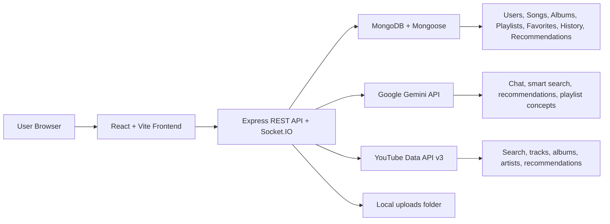

# MelodyMind - AI Music Streaming App

MelodyMind is a full-stack music streaming and discovery platform built for an educational portfolio project. It combines a React frontend, Express API, MongoDB data models, YouTube Data API music discovery, and Google Gemini-powered AI features such as smart search, AI chat, personalized recommendations, and playlist generation.

## Project Status

This project is prepared as a portfolio/CV demo application. It includes role-based user flows, AI-assisted discovery, local media uploads, admin moderation, real-time events, and documented setup instructions.

Quality checks:

```bash
cd backend
npm test

cd ../frontend
npm run lint
npm run build
```

## Features

- Listener, artist, and admin authentication with JWT.
- YouTube-powered search, track details, album details, new releases, and recommendations.
- Local music library with artist uploads for songs, albums, podcasts, lyrics, cover art, and metadata.
- Music player, queue, now-playing view, favorites, downloads, listening history, and playlists.
- AI chat for music questions and local-library recommendations.
- AI playlist generation with source labels for YouTube API and local library tracks.
- Personalized AI recommendations based on listening history, favorite genres, local library signals, and time context.
- Recommendation history page showing previous AI recommendations and their sources.
- Smart natural-language search by mood, genre, year, artist, album, or remembered lyrics.
- Artist studio for uploads and content management.
- Admin dashboard for users, artists, songs, albums, reports, analytics, and moderation.
- Graceful fallbacks when Gemini or YouTube is unavailable, rate limited, or missing an API key.

## Architecture



### Request Flow

1. The React frontend calls the Express API through Axios services.
2. Express validates requests, checks JWT auth where required, and calls controllers.
3. Controllers read and write MongoDB through Mongoose models.
4. AI endpoints call Gemini for analysis and YouTube for external music results.
5. If Gemini fails, the backend uses predefined local fallback profiles.
6. If YouTube fails or quota expires, the backend returns local library results or an empty state with a useful warning.

## Tech Stack

### Frontend

- React 19
- Vite
- React Router
- Tailwind CSS
- Framer Motion
- Axios
- Socket.IO Client
- React Hot Toast
- React Icons

### Backend

- Node.js
- Express 5
- MongoDB
- Mongoose
- JWT authentication
- bcrypt password hashing
- Socket.IO
- Multer file uploads
- Helmet
- CORS
- Express Rate Limit

### External APIs

- Google Gemini API
- YouTube Data API v3

## Setup Instructions

### Prerequisites

- Node.js 18 or newer
- MongoDB local server or MongoDB Atlas database
- YouTube Data API v3 key
- Google Gemini API key

### 1. Clone and Install

```bash
git clone <your-repository-url>
cd music-ai-streaming-app

cd backend
npm install

cd ../frontend
npm install
```

### 2. Configure Environment Variables

Copy the backend example file:

```bash
cd backend
cp .env.example .env
```

### 3. Start the Backend

```bash
cd backend
npm run dev
```

Backend URL:

```txt
http://localhost:5000
```

### 4. Start the Frontend

```bash
cd frontend
npm run dev
```

Frontend URL:

```txt
http://localhost:5173
```

### 5. Optional: Seed Demo Users

```bash
cd backend
npm run seed:demo
```

## API List

Base URL:

```txt
http://localhost:5000/api
```

## AI Explanation

MelodyMind uses Gemini and local fallback logic together.

- Gemini is used for chat, natural-language search parsing, personalized recommendation summaries, and playlist concepts.
- YouTube Data API is used for external music discovery and streaming metadata.
- MongoDB stores users, local songs, albums, playlists, listening history, favorites, downloads, AI history, and recommendation history.
- Local fallback profiles are used when Gemini is unavailable, missing an API key, over quota, or blocked by network/API errors.
- YouTube fallbacks return local library results where possible, or a clear empty state such as: `YouTube recommendations are temporarily unavailable. Try again later or upload local songs.`
- Recommendation cards and history entries show source labels, including `Gemini analysis`, `YouTube API`, `Local library`, and `User listening history`.

## Code Quality Notes

- Request validation is handled with custom validators and middleware.
- Central error handling returns consistent JSON error responses.
- Profile updates are scoped to user-owned fields; subscription changes are managed through admin controls.
- Rate limiting is enabled for API routes.
- Debug logging is disabled by default and controlled through environment flags.
- Recommendation history stores clean source metadata for explainability.

